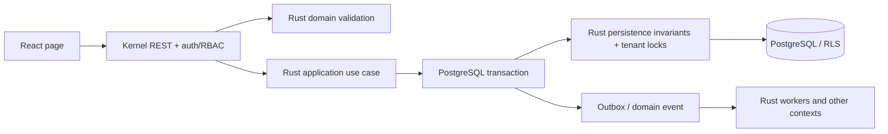

# Kiến trúc module OSP Suite

Hệ thống được chia theo **bounded context**. Mỗi module sở hữu quy tắc nghiệp vụ của mình; module khác chỉ phối hợp qua use case Rust, sự kiện nghiệp vụ hoặc API kernel. PostgreSQL là nơi lưu trạng thái giao dịch; React chỉ hiển thị và gửi lệnh.

## Cấu trúc chuẩn

```text
definitions/modules/<module>.json   # schema dữ liệu, trạng thái, quyền, sự kiện
server/src/modules/<module>/
  mod.rs                             # facade công khai của bounded context
  domain.rs                          # quy tắc thuần, bất biến, chuyển trạng thái
  application.rs                     # facade use case; khi lớn có thể chuyển thành application/mod.rs
  persistence.rs                     # kiểm tra tham chiếu/tenant/đồng thời trong Tx
  reports.rs                         # truy vấn báo cáo, nếu module sở hữu báo cáo
modules/<module>/README.md           # nghiệp vụ, luồng API, giới hạn
client/src/<Module>Page.jsx          # màn hình React theo luồng người dùng
```

Không phải module nào cũng cần đủ mọi file. Giữ lớp không cần thiết ngoài module. File `mod.rs` chỉ xuất bề mặt nhỏ mà `server/src/modules/mod.rs` và kernel cần gọi.

Khi một context lớn lên, chỉ tách tiếp bên trong đúng lớp đang phình to, ví dụ `application/{pricing,source_events}.rs` hoặc `persistence/{periods,bank_statements}.rs`. Lớp có thể bắt đầu bằng `application.rs`; khi cần chia nhỏ, chuyển thành `application/mod.rs` làm facade và đặt từng use case trong file riêng. Các handler sự kiện khác nhau nên nằm trong các file riêng dưới `application/events/`. File facade giữ API ổn định. Không tạo thêm crate/service cho từng nghiệp vụ nhỏ; các module vẫn là bounded context trong một Rust modular monolith. `server/src/modules/events.rs` là composition root, giữ thứ tự gọi các nhóm trong `events/{inventory_orders,support,finance_commerce}.rs`; luật chuyển đổi và ghi dữ liệu vẫn do module nguồn/đích sở hữu.

Ví dụ hiện tại: Construction tách kiểm tra BOQ, công trường/nhật ký và hợp đồng thầu phụ; Charity tách chương trình, biên nhận quyên góp và giải ngân; Purchasing tách đối chiếu nhận hàng và trả hàng/kiểm định. Inventory đặt handler điều chuyển/kiểm kê và handler sự kiện nguồn trong `application/events/{transfer_count,source_stock}.rs`, chuẩn bị dòng tracked-item và định giá stock move trong `application/preparation/{tracked_lines,stock_move}.rs`; facade giữ tên hàm ổn định cho composition root. Accounting tách mẫu hệ thống tài khoản thành `application/chart_templates.rs`, phân giải tài khoản vào `application/accounts.rs`, thao tác ghi bút toán vào `application/journal_posting.rs` và luồng phân bổ phế phẩm sản xuất vào `application/manufacturing.rs`; `application/mod.rs` chỉ giữ facade cùng các re-export cần thiết. Quality tách xác thực giải phóng một phần hàng bị giữ trong `persistence/inspection_disposition.rs`; facade giữ bộ định tuyến kiểm tra theo loại entity. Asset dùng `domain/depreciation.rs` làm chính sách Decimal chung cho chuẩn bị phiếu và báo cáo dự báo, còn `application/` tách chuẩn hóa tài sản, lập khấu hao và handler vốn hóa, thanh lý, ghi sổ khấu hao. Các facade vẫn là điểm gọi duy nhất của kernel.

## Bộ khung nghiệp vụ nhỏ

Một luồng nhỏ nên có một đường đi trọn vẹn, thay vì chia lớp theo thao tác CRUD riêng lẻ:

1. Khai báo entity, field, trạng thái và quyền trong `definitions/modules/<module>.json`.
2. Đặt luật thuần và các điều kiện chuyển trạng thái trong `domain.rs`.
3. Tạo hàm application có tên theo nghiệp vụ (ví dụ `approve_*`, `post_*`, `handle_source_event`) để chuẩn hóa đầu vào và điều phối các bước.
4. Đặt kiểm tra tenant, tham chiếu, chống trùng và khóa cạnh tranh trong `persistence.rs`; cùng transaction với thay đổi trạng thái.
5. Chỉ xuất hàm cần dùng qua `mod.rs`; module khác gọi facade thay vì đi vào file nội bộ.
6. Ghi luồng, quyền, phụ thuộc, giới hạn và cách dùng trong `modules/<module>/README.md`.

Với luồng liên module có bút toán hoặc tồn kho, ghi nhận chứng từ nguồn và phát event trong cùng transaction. Consumer phải xử lý idempotent. Cập nhật các sự kiện mới vào `events.rs`; không đặt công thức nghiệp vụ hoặc SQL truy vấn tùy ý vào dispatcher.

Action trạng thái dùng chung có thể chạy qua `/data/<module>/<entity>/bulk/<action>` cho 1–100 ID. UI chỉ chọn bản ghi và gửi command; Rust giữ nguyên quyền, kiểm tra nghiệp vụ, audit và phát sự kiện như action đơn. Kernel xử lý theo thứ tự ID trong một transaction tenant, nên lỗi ở bất kỳ bản ghi nào sẽ rollback cả lô. Không đưa luật nghiệp vụ từng module vào tiện ích bulk.

## Trách nhiệm và ranh giới

| Lớp | Trách nhiệm | Không đặt ở đây |
|---|---|---|
| Catalog JSON | Mô tả schema, field, trạng thái, quyền, event và chỉ mục sinh được | Công thức tiền/kho hoặc logic cần transaction |
| `domain.rs` | Kiểm tra bất biến thuần, điều kiện action, chuyển trạng thái hợp lệ | I/O, SQL, gọi HTTP |
| `application.rs` | Một use case có tên rõ, chuẩn hóa dữ liệu và gọi context cần thiết | SQL tùy tiện từ client |
| `persistence.rs` | Ràng buộc liên bản ghi và tenant, khóa cạnh tranh, chống trùng trong transaction | Hiệu ứng ngoài transaction như gửi mail trực tiếp |
| React | Thu thập dữ liệu, hiển thị trạng thái, gọi endpoint kernel/Rust | Tự tính hoặc tự ghi sổ nghiệp vụ |

## Quy tắc bắt buộc cho module mới

1. Đặt mọi dữ liệu doanh nghiệp dưới `tenant_id`; mọi truy vấn theo tenant phải nhận tenant từ phiên xác thực, không nhận tenant thay thế từ body.
2. Tiền, tồn kho, phân bổ và thay đổi trạng thái quan trọng được kiểm tra trong Rust. Tiền và số lượng thập phân dùng `rust_decimal::Decimal`; đọc PostgreSQL `numeric` qua text, dùng phép toán checked và tuần tự hóa JSON bằng adapter tiền dùng chung. Các kiểm tra cần cùng lúc với ghi dữ liệu chạy trong cùng PostgreSQL transaction và khóa bản ghi khi có thể có request cạnh tranh.
3. Tác vụ lặp phải idempotent; sự kiện phát ra sau khi ghi thành công. Gửi mail, SMS và webhook đi qua outbox/queue.
4. Không chấp nhận SQL, tên bảng hoặc field tùy ý từ trình duyệt. Saved report chỉ dùng DSL được Rust kiểm tra; tên nguồn và field phải tra qua catalog.
5. Ghi rõ quyền đọc/ghi và tham chiếu liên module. Kiểm tra quyền ở server; ẩn nút ở React chỉ để thuận tiện giao diện.
6. Với luồng có tác động kế toán/kho, lưu snapshot nguồn và dấu vết audit; không sửa chứng từ đã ghi sổ, hãy tạo chứng từ đảo hoặc điều chỉnh.
7. Cập nhật README module, changelog và roadmap cùng thay đổi. Chạy `npm run new:module -- <id>` để tạo bộ khung, sau đó đăng ký facade/dispatch Rust theo hướng dẫn của generator.

Catalog lint là hàng rào kiến trúc: module phải khai báo dependency và không được import trực tiếp `application`, `domain`, `persistence`, `reports` hoặc `worker` nội bộ của context khác.

## Luồng ghi chuẩn



## Tích hợp provider bất đồng bộ: e-invoice

Yêu cầu `einvoice.einvoice` được tạo trong transaction ghi sổ hóa đơn kế toán và đồng thời là bản ghi công việc bền vững. Worker claim theo tenant bằng `FOR UPDATE SKIP LOCKED`, cấp `lease_token`, commit trước khi gọi HTTPS rồi mở transaction mới để lưu phản hồi và chạy action của kernel. Token lease ngăn worker cũ ghi đè kết quả của worker mới; provider nhận `Idempotency-Key` ổn định theo mã yêu cầu để xử lý trường hợp tiến trình dừng sau phản hồi bên ngoài nhưng trước commit PostgreSQL. Hủy dùng trạng thái `cancellation_pending` và chỉ sang `cancelled` sau khi phản hồi provider được lưu. Endpoint vắng mặt thì hàng đợi không bị claim; lỗi được ghi thành `failed`, người có quyền dùng action `retry` để xử lý lại. Trait provider nhận tenant ID; adapter vendor riêng được tiêm qua `spawn_einvoice_worker_with_provider`, còn REST mặc định dùng cấu hình môi trường.

## Ví dụ phân rã use case nhập sao kê

Luồng `accounting.bank_import` giữ facade nhỏ để API công khai ổn định. `bank_import/model.rs` định nghĩa dòng sao kê chuẩn dùng chung; `csv.rs` và `camt053.rs` chỉ chuyển định dạng đầu vào sang model này; `import.rs` kiểm quyền và điều phối use case; `persistence.rs` khóa sao kê, kiểm tra tenant/kỳ/tham chiếu và ghi tất cả dòng trong một transaction. HTTP chỉ nhận tệp UTF-8, React chỉ chọn và gửi tệp; không parser nghiệp vụ hay SQL nào chạy ở client. Khi thêm định dạng khác, parser mới phải trả cùng `BankLine` và đi qua cùng use case/persistence.

Ở inventory, `preparation/stock_move.rs` điều phối khóa tồn, số lượng khả dụng và FIFO; `preparation/lot_availability.rs` xác thực truy xuất lô, hạn dùng và lượng bị QC giữ; `preparation/source_cost.rs` xử lý đơn giá theo nguồn mua hàng, sản xuất, điều chuyển, trả hàng, POS và kiểm kê. Mỗi workflow dùng cùng transaction để giữ nguyên tính nhất quán tồn kho.

Ở accounting, facade event `ledger/source_documents.rs` định tuyến posting hóa đơn bán, bill mua, credit/debit note, đảo bút toán và trả hàng sang các workflow con. Mỗi workflow nhận cùng `Tx` của kernel, ghi sổ theo Decimal và trả kết quả cho dispatcher; module con không tự mở connection hay commit transaction.

## Module mẫu hiện tại: BI

BI giữ schema dashboard/report/KPI trong catalog. `domain.rs` chỉ nhận loại widget đã hỗ trợ và DSL báo cáo an toàn; `application.rs` chuẩn hóa truy vấn; `persistence.rs` đảm bảo widget tham chiếu report trong cùng tenant và kiểu widget khớp query; kernel thực thi report qua API dữ liệu đã phân quyền và xuất CSV theo cùng bộ lọc, có giới hạn số dòng và bảo vệ formula injection. HTTP chỉ điều phối và trả file. React không truy cập PostgreSQL và không dựng SQL. Báo cáo/dashboards được mở ở `#/reports/bi`.

Các kiểu biểu đồ hiện có: table cho query danh sách; number cho aggregate đơn; line/bar/pie cho aggregate có group. KPI formula, lịch gửi báo cáo và xuất PDF/Excel chưa thuộc phạm vi luồng BI này.
